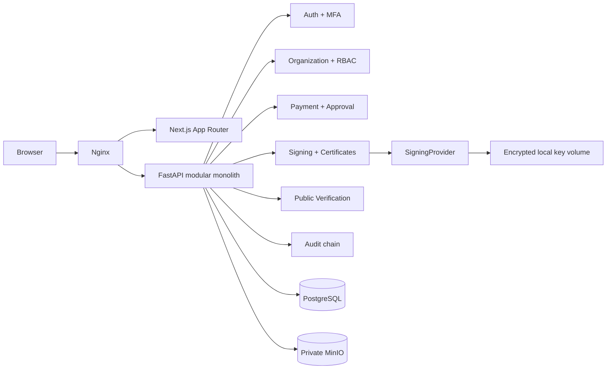

# Architecture

PaySeal is a modular monolith: one Next.js application, one FastAPI process, one PostgreSQL database, and private MinIO object storage behind Nginx. Module boundaries live in API routers, application services, crypto adapters, and tenant-scoped persistence operations. This keeps the transaction boundary local while leaving signing and object storage replaceable.

## Trust and transaction boundaries

- Nginx applies an outer request-size and rate boundary; FastAPI independently validates authorization, payloads, file magic, and size.
- Organization membership is loaded from the access-token user plus the `X-Organization-ID` header. Every tenant resource query includes `organization_id`; a missing membership returns a non-enumerating 404.
- Approval, signing, and revocation lock the payment row. State transitions are allow-listed in the payment service.
- Beneficiary accounts and snapshot accounts use AES-256-GCM. HMAC-SHA256 supports equality lookup without exposing plaintext.
- The local signing provider stores AES-GCM-wrapped PKCS#8 keys on a private volume. Only public JWK and provider identifiers enter PostgreSQL.

## Session and frontend boundaries

- Refresh tokens are opaque random values stored as hashes and transported in an HttpOnly SameSite cookie. Refresh and logout require the session's CSRF header.
- The frontend shares one session context across pages. API transport handles JSON and PDF, translates errors, and coordinates token refresh so concurrent requests do not rotate the same refresh token twice.
- Resource queries cancel obsolete requests on navigation. Common loading, empty, retry, and busy-button states are reusable components.
- Payment amounts use integer minor units; decimal inputs are parsed without floating-point rounding.
- CSS transitions animate opacity and transforms. Reduced-motion preferences disable decorative motion; the mobile menu supports focus trapping, Escape, and focus restoration.

## Business review and sandbox provider

BusinessVerification stores a profile snapshot, private evidence hash/key, independent checks/decision and expiry. Reviewer permission is separate from organization roles and provisioned only by a server operator. Identity changes invalidate approved trust; new certificates reflect new assurance while old signatures stay immutable.

TransferProvider separates sandbox instructions/receipts from authorization and persists a simulated provider ledger. Transfer rows bind to signed versions; uniqueness constraints and organization/payment locks prevent duplicates. The guarded payOS boundary uses the official SDK, encrypted immutable per-tenant collection/payout channels, authenticated responses, durable reservation and fixed provider idempotency. Financial side effects occur after reservation/dispatch commits. Unknown outcomes are queried, never blindly resubmitted. A separate worker only reconciles; it never creates payouts. Collection callbacks trigger authenticated cumulative-state lookup, not arithmetic crediting. No real credentials, live acceptance test, external KYB or independent bank-statement/settlement feed is configured; see [go-live](go-live.md).

## Signing and PDF sequence

1. Allocate a 256-bit random public token and stable verification URL.
2. Render the final visual PDF containing the URL and QR.
3. Hash the exact PDF bytes with SHA-256.
4. Build and deterministically serialize the payment manifest, including the document hash.
5. Sign the manifest as ES256 compact JWS.
6. Store the PDF under a random UUID object key in a private bucket.

The PDF does not embed its own hash, avoiding a circular dependency. Its QR resolves to the signed manifest and upload comparison endpoint.

