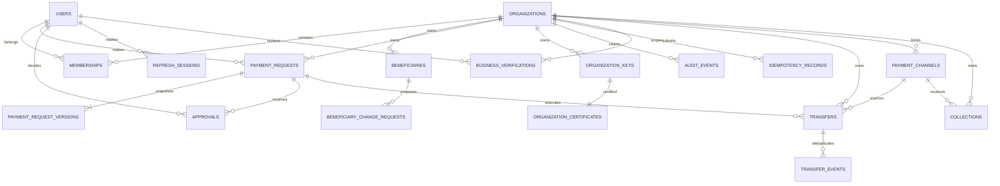

# Database model

Payment amounts are signed 64-bit integer minor units. `payment_requests` owns mutable lifecycle metadata; `payment_request_versions` owns the immutable business snapshot used when signing. Unique constraints protect membership, approval-per-user, version numbers, public tokens, key IDs, and idempotency scopes.

Private keys never appear in this schema. Account plaintext never appears in beneficiary or version account columns. The signed JWS payload necessarily carries the account instruction for cryptographic binding, but no authenticated or public API returns that plaintext; public responses return only a masked form.

